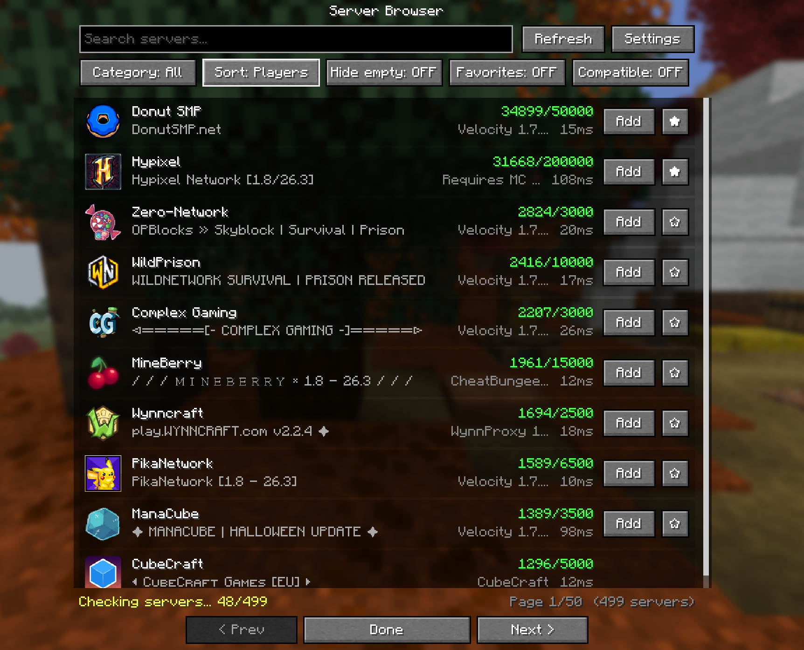
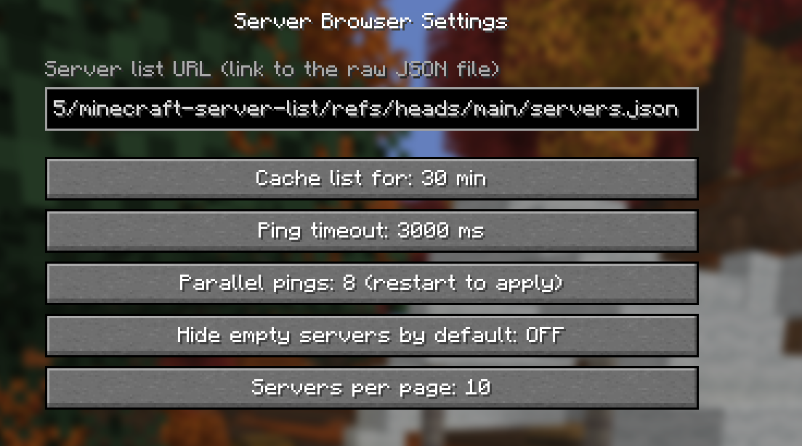

# **VSM (Vanquish's Server Browser)**

VSM is a lightweight and user-friendly Fabric mod designed to improve your multiplayer experience by providing a seamless, feature-rich server browsing and management interface directly inside Minecraft.  

### ✨ Features

- Advanced Server Browser UI: Enjoy a streamlined browser screen
- Real-time Server Pinging: Efficiently check server status, player counts, and latency with the integrated batch server pinger
- Favorites & Configuration: Easily bookmark your preferred servers and customize your experience using the configuration and favorites system
- Mod Menu Integration: Fully compatible with Mod Menu for quick access to mod settings straight from your mod list
- Dynamic Server Management: Fetch, add, and manage servers effortlessly through automated server list fetching and entry handlers

📥 **Installation**

1. Ensure you have Fabric Loader installed for your target Minecraft version.
2. Download the latest VSM mod jar and place it in your mods folder.
3. (Optional) Install Mod Menu to easily configure mod options in-game.

### Settings
- You can customize nearly everything
- You can change the list for a better list

## You want your Server to be added as well?
Create a PR for: https://github.com/Vanquish1905/minecraft-server-list. Just add your server's info to the json like the others are.